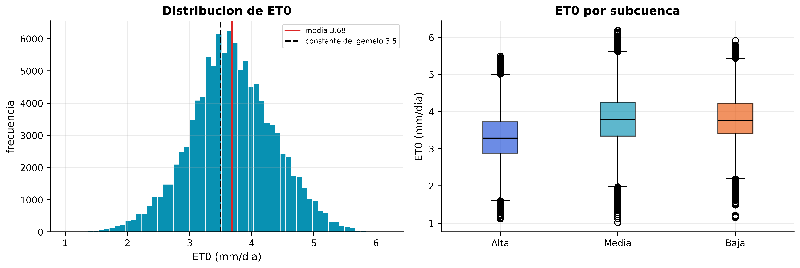
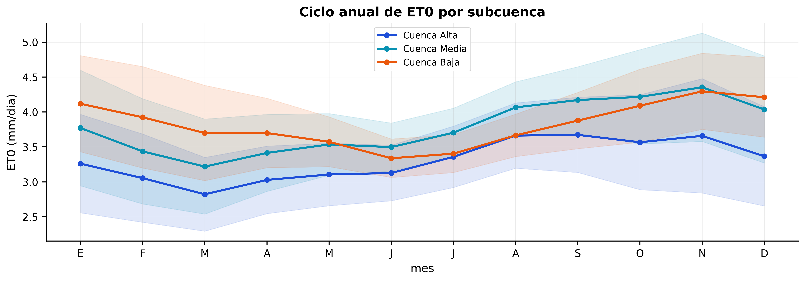
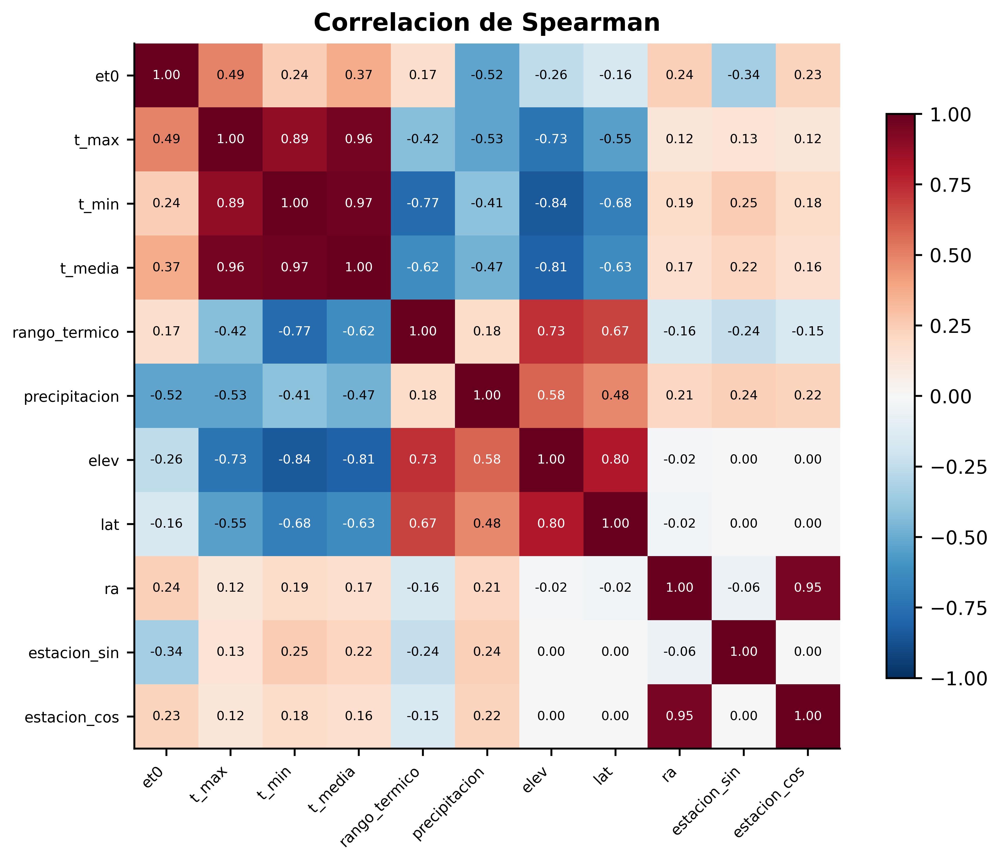
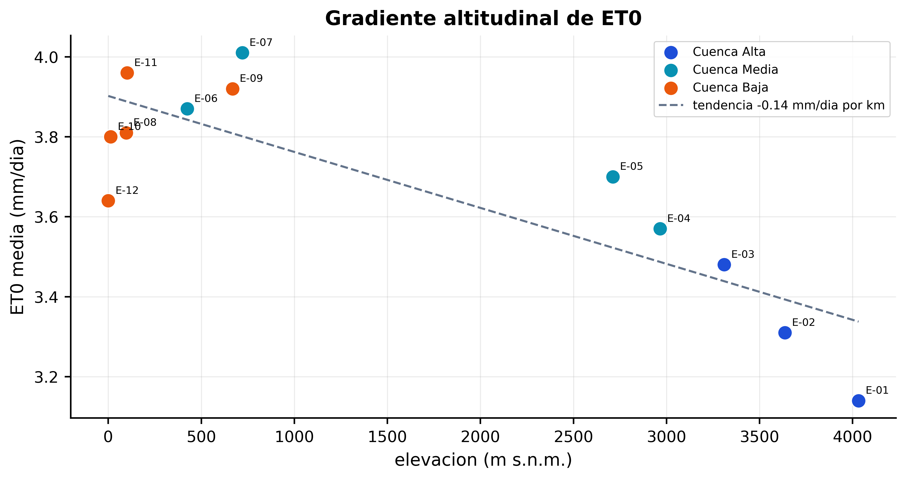
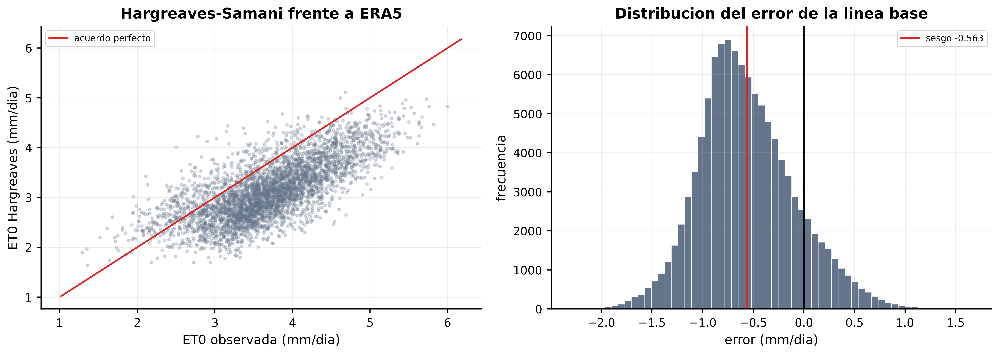
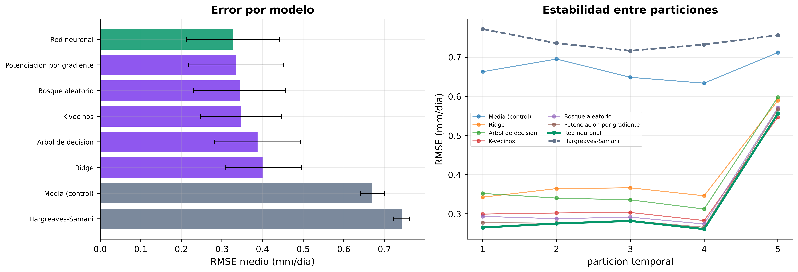
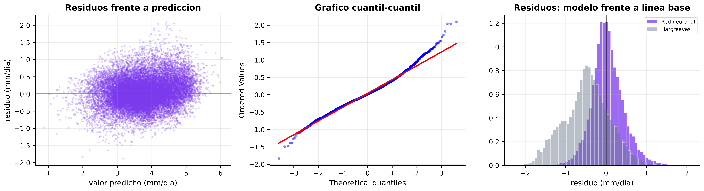
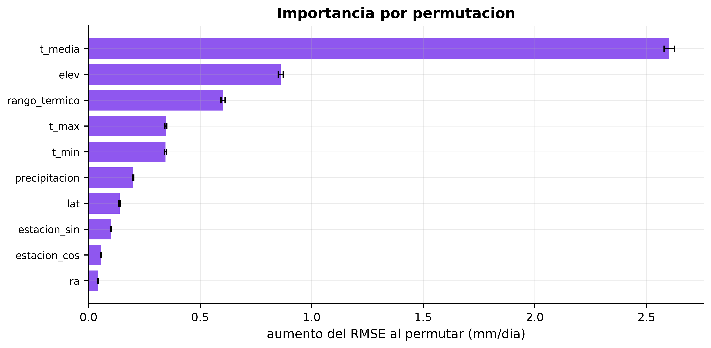
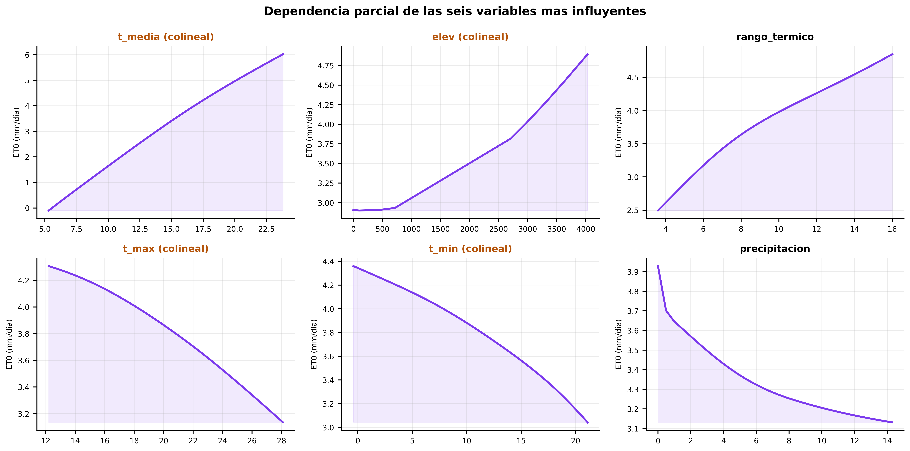
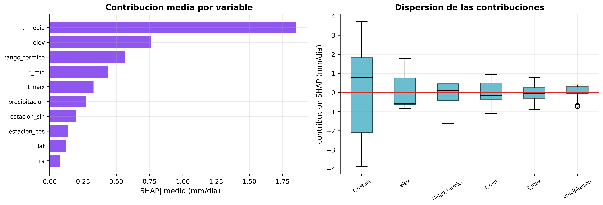

# Estimacion de evapotranspiracion de referencia en la cuenca del Rio Moche

Estudio CRISP-DM sobre reanalisis ERA5 para alimentar el modelo GR4J del gemelo digital

---

## Fase 1. Comprension del negocio

_Definir que problema resuelve el modelo dentro del gemelo digital y con que criterio se declarara util._

El modelo hidrologico GR4J del gemelo exige evapotranspiracion de referencia (ET0) como entrada obligatoria en cada paso de tiempo. Hoy el gemelo la rellena con una constante de 3.5 mm/dia cuando el operador no la aporta, porque las estaciones de la cuenca del Moche miden temperatura y lluvia pero rara vez radiacion solar, viento y humedad, que son los sensores caros.

**Objetivo.** Estimar ET0 diaria usando solo variables baratas: temperatura maxima y minima, precipitacion, altitud y fecha.

**Criterio de exito.** Superar de forma estadisticamente significativa a la ecuacion de Hargreaves-Samani, que es el metodo que la propia FAO recomienda cuando faltan datos. Competir contra la practica establecida, y no contra un promedio ingenuo, es lo que da valor al resultado.

---

## Fase 2. Comprension de los datos

_Describir el origen, verificar la calidad y explorar la estructura antes de modelar._

**Fuente.** Reanalisis ERA5 servido por la API publica de Open-Meteo, sin credenciales. **Cobertura.** 109,584 registros diarios de 12 estaciones del Rio Moche, entre 2000-01-01 y 2024-12-31. Las coordenadas son las mismas que usa el gemelo, con un gradiente de 0 a 4032 metros.

### Tabla 1. Calidad de los datos

| variable | nulos | pct_nulos | minimo | maximo | unicos |
|---|---|---|---|---|---|
| et0 | 0 | 0.0000 | 1.0200 | 6.1800 | 490 |
| t_max | 0 | 0.0000 | 4.4000 | 32.1000 | 255 |
| t_min | 0 | 0.0000 | -5.8000 | 25.2000 | 304 |
| t_media | 0 | 0.0000 | 1.8000 | 27.1000 | 250 |
| precipitacion | 0 | 0.0000 | 0.0000 | 101.1000 | 458 |
| radiacion | 0 | 0.0000 | 5.6300 | 32.8500 | 2354 |
| viento | 0 | 0.0000 | 3.2000 | 27.4000 | 215 |
| humedad | 0 | 0.0000 | 30.0000 | 99.0000 | 70 |
| elev | 0 | 0.0000 | 0.0000 | 4032.0000 | 12 |

**Qué muestra.** Recuento de ausentes, rango observado y numero de valores distintos por variable.

**Cómo leerlo.** Las columnas de nulos deben ser cero. Los minimos y maximos sirven para detectar imposibles fisicos, como una humedad relativa mayor que cien o una precipitacion negativa.

**Interpretación.** No hay un solo valor ausente, de modo que no se imputa nada y ninguna metrica posterior queda contaminada por relleno artificial. Los rangos son fisicamente plausibles: la ET0 va de 1.02 a 6.18 mm/dia, propio de una cuenca que abarca desde el nivel del mar hasta la puna. Se descartaron 0 filas sin objetivo y 0 con temperatura maxima inferior a la minima.

### Tabla 2. Resumen estadistico de las variables

| variable | count | mean | std | min | 25% | 50% | 75% | max |
|---|---|---|---|---|---|---|---|---|
| et0 | 109584.0000 | 3.6830 | 0.6800 | 1.0200 | 3.2500 | 3.6600 | 4.1300 | 6.1800 |
| t_max | 109584.0000 | 20.3990 | 4.7980 | 4.4000 | 16.3000 | 21.6000 | 24.2000 | 32.1000 |
| t_min | 109584.0000 | 12.0440 | 6.7150 | -5.8000 | 6.1000 | 14.5000 | 17.6000 | 25.2000 |
| t_media | 109584.0000 | 15.6600 | 5.7330 | 1.8000 | 10.8000 | 17.7000 | 20.4000 | 27.1000 |
| rango_termico | 109584.0000 | 8.3550 | 3.1400 | 1.0000 | 6.0000 | 7.9000 | 10.4000 | 23.1000 |
| precipitacion | 109584.0000 | 2.8230 | 5.3720 | 0.0000 | 0.0000 | 0.2000 | 3.1000 | 101.1000 |
| elev | 109584.0000 | 1556.5830 | 1545.7000 | 0.0000 | 100.0000 | 694.5000 | 3051.2500 | 4032.0000 |

**Qué muestra.** Tendencia central, dispersion y cuartiles de las variables que intervienen en el estudio.

**Cómo leerlo.** Comparar la media con la mediana revela asimetria. La desviacion frente a la media da el coeficiente de variacion, que indica cuanta senal hay que explicar.

**Interpretación.** La ET0 promedia 3.68 mm/dia con desviacion 0.68, es decir un coeficiente de variacion de 18.5%. Esa variabilidad es justamente lo que se pierde al sustituirla por la constante de 3.5 mm/dia que usa hoy el gemelo: la constante acierta en el promedio pero yerra sistematicamente en los extremos. La precipitacion es muy asimetrica (media 2.82 frente a mediana 0.20 mm), lo normal en clima semiarido donde la mayoria de dias no llueve.

### Figura 1. Distribucion de ET0 global y por subcuenca

**Qué muestra.** A la izquierda el histograma de la variable objetivo con la media y la constante que usa hoy el gemelo. A la derecha la misma variable separada por tramo de cuenca.

**Cómo leerlo.** En el histograma interesa la forma y la anchura. En las cajas, la linea central es la mediana, la caja abarca el cincuenta por ciento central y los bigotes el resto salvo atipicos.

**Interpretación.** La distribucion es simetrica (asimetria 0.00) y se concentra entre 3.25 y 4.13 mm/dia. La constante de 3.5 mm/dia cae dentro del rango central, lo que explica que el gemelo no produzca disparates, pero queda +0.18 mm/dia respecto a la media real. Por subcuenca la mediana varia 0.49 mm/dia entre la Media (3.78) y la Alta (3.29), prueba de que una sola constante no puede servir para toda la cuenca.

### Figura 2. Ciclo anual de ET0

**Qué muestra.** Media mensual de ET0 en cada tramo de la cuenca. La banda sombreada es una desviacion tipica.

**Cómo leerlo.** Si las curvas suben y bajan con el mes, existe estacionalidad y el modelo debe recibir la fecha como predictor. La separacion vertical entre curvas mide cuanto pesa la posicion en la cuenca.

**Interpretación.** Hay un ciclo anual claro, con maximo en noviembre (4.16 mm/dia) y minimo en marzo (3.32), una amplitud de 0.84 mm/dia que representa el 23% de la media. Esto justifica codificar el dia del anio como seno y coseno en la fase de preparacion. Las tres curvas mantienen distancia entre si durante todo el anio, de modo que la altitud actua como desplazamiento y no solo como ruido.

### Tabla 3. Correlacion de cada predictor con ET0

| predictor | rho_con_ET0 |
|---|---|
| precipitacion | -0.5244 |
| t_max | 0.4926 |
| t_media | 0.3743 |
| estacion_sin | -0.3388 |
| elev | -0.2576 |
| t_min | 0.2440 |
| ra | 0.2392 |
| estacion_cos | 0.2257 |
| rango_termico | 0.1737 |
| lat | -0.1630 |

**Qué muestra.** Coeficiente de Spearman entre cada variable disponible y la variable objetivo.

**Cómo leerlo.** Spearman mide asociacion monotona, no solo lineal, asi que tolera relaciones curvas. Valores cercanos a uno en valor absoluto indican predictores potentes; cercanos a cero, poco utiles por si solos.

**Interpretación.** El predictor mas asociado es 'precipitacion' con rho de -0.524, asociacion moderada. Existen 3 pares de predictores con correlacion superior a 0.9 (t_max-t_media, t_min-t_media, ra-estacion_cos), lo que anticipa problemas de colinealidad para los modelos lineales y aconseja incluir metodos basados en arboles, que son inmunes a ella.

### Figura 3. Matriz de correlacion

**Qué muestra.** Correlacion de Spearman entre la variable objetivo y todos los predictores.

**Cómo leerlo.** El azul intenso marca asociacion positiva y el rojo intenso, negativa. La primera fila y columna muestran la relacion con ET0; el resto del cuadro revela redundancia entre predictores.

**Interpretación.** La estructura confirma que la informacion util esta repartida y no concentrada en una sola variable: el mejor predictor individual solo alcanza rho -0.524. Esto sugiere que un modelo capaz de combinar varias entradas superara a cualquier formula que dependa de una sola, y es el argumento de partida para probar metodos no lineales.

### Tabla 4. Caracterizacion de las estaciones

| estacion | nombre | subcuenca | elevacion | et0_media | et0_desv | t_media | lluvia_anual |
|---|---|---|---|---|---|---|---|
| E-01 | Quiruvilca Cabecera | Alta | 4032.0000 | 3.1400 | 0.6000 | 5.5100 | 2446.4000 |
| E-02 | Shorey Confluencia | Alta | 3636.0000 | 3.3100 | 0.6300 | 7.8900 | 2544.3000 |
| E-03 | Julcan Agricola Alto | Alta | 3310.0000 | 3.4800 | 0.6600 | 9.7000 | 2114.9000 |
| E-04 | Otuzco Hidrometrica | Media | 2965.0000 | 3.5700 | 0.6700 | 11.8400 | 2436.5000 |
| E-05 | Usquil Valles | Media | 2712.0000 | 3.7000 | 0.6800 | 12.6900 | 1331.8000 |
| E-06 | Simbal Estacion Central | Media | 424.0000 | 3.8700 | 0.6100 | 19.4800 | 170.1000 |
| E-07 | Poroto Toma de Riego | Media | 721.0000 | 4.0100 | 0.7700 | 20.5500 | 549.6000 |
| E-08 | Laredo Agroindustrial | Baja | 97.0000 | 3.8100 | 0.5700 | 20.1600 | 154.1000 |
| E-09 | Quirihuac Puente | Baja | 668.0000 | 3.9200 | 0.6300 | 18.7800 | 171.2000 |
| E-10 | Campina de Moche | Baja | 13.0000 | 3.8000 | 0.5500 | 20.6800 | 151.8000 |
| E-11 | Conache Laguna Control | Baja | 101.0000 | 3.9600 | 0.6200 | 20.8300 | 154.1000 |
| E-12 | Boca de Rio Moche | Baja | 0.0000 | 3.6400 | 0.5200 | 19.8200 | 151.8000 |

**Qué muestra.** Elevacion, ET0 media y dispersion, temperatura media y lluvia anual de cada estacion.

**Cómo leerlo.** Ordenando mentalmente por elevacion se aprecia como cambian las demas columnas. La desviacion de ET0 indica cuanta variabilidad interna tiene cada punto.

**Interpretación.** Las 12 estaciones cubren de 0 a 4032 metros, con ET0 media de 3.14 a 4.01 mm/dia. Esta heterogeneidad es deseable: obliga al modelo a generalizar entre ambientes distintos en lugar de memorizar un microclima. Tambien justifica validar dejando estaciones completas fuera, que es lo que se hace en la fase de modelado.

### Figura 4. Gradiente altitudinal de ET0

**Qué muestra.** ET0 media de cada estacion frente a su elevacion, con la recta de tendencia ajustada.

**Cómo leerlo.** Cada punto es una estacion. La pendiente de la recta cuantifica cuanto cambia la ET0 por cada kilometro de ascenso.

**Interpretación.** La relacion con la altitud es debil (rho -0.258) y la tendencia indica -0.14 mm/dia por cada mil metros. La ET0 disminuye al ascender, coherente con el descenso termico con la altura. La altitud debe entrar como predictor, y ademas explica por que una constante unica para toda la cuenca es inadecuada.

### Figura 5. Desempenio de la linea base Hargreaves-Samani

**Qué muestra.** A la izquierda, valores estimados por la ecuacion frente a los de referencia. A la derecha, la distribucion de los errores.

**Cómo leerlo.** En el grafico de dispersion, cuanto mas se peguen los puntos a la diagonal, mejor. En el histograma, un centro desplazado del cero delata sesgo sistematico y una anchura grande, imprecision.

**Interpretación.** La ecuacion alcanza RMSE de 0.737 mm/dia y correlacion de 0.726, asociacion fuerte. El error medio es -0.563 mm/dia, es decir que subestima la evapotranspiracion de forma sistematica en un 15.3% de la media. Este sesgo es un defecto conocido de Hargreaves fuera de las condiciones para las que se calibro, y marca el objetivo concreto a batir: cualquier modelo propuesto debera reducir el RMSE de 0.737 y, sobre todo, eliminar ese sesgo.

---

## Fase 3. Preparacion de los datos

_Construir las variables derivadas y separar entrenamiento de prueba sin filtrar informacion del futuro._

**Variables derivadas.** Rango termico diario, que actua como sustituto barato de la radiacion porque un cielo despejado calienta mucho de dia y enfria mucho de noche. Radiacion extraterrestre por geometria orbital, que no requiere instrumento alguno. Estacionalidad codificada como seno y coseno del dia del anio, para que el 31 de diciembre y el 1 de enero queden contiguos en lugar de separados por todo el rango.

**Exclusion deliberada.** El modelo no recibe radiacion medida, viento ni humedad, pese a estar disponibles en la fuente. Incluirlas volveria el problema casi trivial, porque la ecuacion FAO-56 las usa directamente, y el resultado no serviria a una estacion peruana real que carece de esos sensores. Se renuncia a precision para ganar aplicabilidad.

**Particion.** Entrenamiento 87,660 registros (2000-01-01 a 2019-12-31); prueba 21,924 registros (2020-01-01 a 2024-12-31). El corte es temporal: una particion aleatoria colocaria dias contiguos a ambos lados y, al estar autocorrelacionados, devolveria metricas infladas.

**Predictores finales (10).** t_max, t_min, t_media, rango_termico, precipitacion, elev, lat, ra, estacion_sin, estacion_cos

---

## Fase 4. Modelado

_Comparar familias de modelos bajo validacion cruzada temporal, elegir la mejor y ajustar sus hiperparametros._

Se emplean 5 particiones temporales expansivas sobre 87,660 registros de entrenamiento (2000-01-01 a 2019-12-31). En cada particion el modelo aprende del pasado y se evalua sobre un tramo posterior que nunca ha visto.

### Tabla 5. Comparacion de modelos en validacion cruzada temporal

| puesto | modelo | RMSE_medio | RMSE_desv | MAE_medio | R2_medio | sesgo_medio | segundos |
|---|---|---|---|---|---|---|---|
| 1 | Red neuronal | 0.3279 | 0.1143 | 0.2498 | 0.7410 | 0.0382 | 48.0706 |
| 2 | Potenciacion por gradiente | 0.3338 | 0.1168 | 0.2537 | 0.7314 | 0.0229 | 5.9932 |
| 3 | Bosque aleatorio | 0.3436 | 0.1138 | 0.2607 | 0.7179 | 0.0185 | 24.1789 |
| 4 | K-vecinos | 0.3470 | 0.1003 | 0.2622 | 0.7173 | 0.0373 | 1.5299 |
| 5 | Arbol de decision | 0.3877 | 0.1060 | 0.2898 | 0.6492 | 0.0174 | 0.9056 |
| 6 | Ridge | 0.4018 | 0.0943 | 0.3142 | 0.6279 | 0.0378 | 0.0975 |
| 7 | Media (control) | 0.6705 | 0.0290 | 0.5273 | -0.0113 | -0.0192 | 0.0130 |
| 8 | Hargreaves-Samani | 0.7425 | 0.0193 | 0.6508 | -0.2468 | -0.5876 | 0.0000 |

**Qué muestra.** Error medio de cada alternativa sobre las 5 particiones temporales, con su dispersion entre particiones y el coste de entrenamiento.

**Cómo leerlo.** Se ordena por RMSE medio, donde menos es mejor. La desviacion indica estabilidad: un modelo con RMSE bajo pero desviacion alta acierta en unos tramos y falla en otros. El control de la media y la ecuacion de Hargreaves actuan como suelo y como referencia practica.

**Interpretación.** Gana 'Red neuronal' con RMSE de 0.3279 mm/dia, un 55.8% mejor que Hargreaves-Samani (0.7425). El ajuste medio alcanza R2 de 0.741, calificado como bueno segun el criterio de Moriasi. El control de la media queda en 0.6705, de modo que todos los modelos aprenden algo real y no estan simplemente prediciendo el promedio. Conviene notar que el sesgo del mejor modelo es +0.0382 mm/dia frente al -0.5876 de Hargreaves: la correccion del error sistematico es mas valiosa que la ganancia en precision, porque un sesgo persistente se acumula al integrar el balance hidrico a lo largo del anio.

### Figura 6. Comparacion de modelos

**Qué muestra.** A la izquierda el error medio de cada alternativa con su barra de dispersion. A la derecha la evolucion del error de cada modelo a lo largo de las particiones temporales sucesivas.

**Cómo leerlo.** En el grafico de barras, mas corto es mejor. En el de lineas interesa la planitud: una curva estable indica que el modelo aguanta el paso del tiempo, mientras que una ascendente delata degradacion conforme se aleja del periodo de entrenamiento.

**Interpretación.** El orden de merito es nitido y 'Red neuronal' domina en todas las particiones. La dispersion entre particiones del ganador es de 0.1143 mm/dia, pequena frente a su error medio, lo que indica un comportamiento estable y no un acierto puntual. 'Hargreaves-Samani' cierra la tabla. Ninguna curva muestra degradacion sostenida hacia la derecha, senal de que la relacion entre temperatura y evapotranspiracion se mantiene en el periodo estudiado.

### Tabla 6. Mejores configuraciones de hiperparametros

| learning_rate_init | hidden_layer_sizes | alpha | RMSE_cv | std_test_score |
|---|---|---|---|---|
| 0.0050 | (64,) | 0.0000 | 0.3625 | 0.1217 |
| 0.0005 | (64,) | 0.0100 | 0.3626 | 0.1204 |
| 0.0005 | (64,) | 0.0010 | 0.3626 | 0.1209 |
| 0.0005 | (32,) | 0.0100 | 0.3637 | 0.1145 |
| 0.0005 | (32,) | 0.0000 | 0.3645 | 0.1131 |
| 0.0005 | (128, 64) | 0.0100 | 0.3667 | 0.1384 |
| 0.0005 | (64, 32) | 0.0010 | 0.3670 | 0.1347 |
| 0.0010 | (128, 64, 32) | 0.0000 | 0.3675 | 0.1385 |

**Qué muestra.** Las ocho combinaciones con menor error de las doce exploradas por busqueda aleatoria sobre 'Red neuronal', evaluadas con la misma validacion cruzada temporal.

**Cómo leerlo.** Cada fila es una configuracion. La columna de error ordena el merito y la desviacion indica si la ventaja es consistente entre particiones o producto del azar de una sola.

**Interpretación.** La mejor configuracion alcanza RMSE de 0.3625 mm/dia frente a 0.3279 de la version por defecto, una ganancia del -10.56%. El ajuste no mejora la configuracion por defecto, indicio de que el rendimiento esta limitado por los predictores y no por los hiperparametros. La busqueda tardo 145 segundos. Parametros elegidos: learning_rate_init=0.005, hidden_layer_sizes=(64,), alpha=1e-05

---

## Fase 5. Evaluacion

_Someter la ventaja observada a contrastes estadisticos y diagnosticar los residuos antes de dar el modelo por valido._

### Tabla 7. Contraste global de Friedman

| modelo | rango_medio | RMSE_medio |
|---|---|---|
| Red neuronal | 1.2000 | 0.3279 |
| Potenciacion por gradiente | 2.2000 | 0.3338 |
| Bosque aleatorio | 3.2000 | 0.3436 |
| K-vecinos | 3.4000 | 0.3470 |
| Arbol de decision | 5.4000 | 0.3877 |
| Ridge | 5.6000 | 0.4018 |
| Media (control) | 7.0000 | 0.6705 |
| Hargreaves-Samani | 8.0000 | 0.7425 |

**Qué muestra.** Rango medio de cada modelo a lo largo de las particiones temporales, base del contraste no parametrico.

**Cómo leerlo.** El rango uno corresponde al mejor modelo en cada particion. Un rango medio cercano a uno indica superioridad consistente y no un promedio favorecido por un solo tramo excepcional.

**Interpretación.** Estadistico de Friedman 33.000 con p < 0.001, diferencia altamente significativa. Se rechaza la hipotesis nula de que todos los modelos rinden igual, de modo que las diferencias observadas no se explican por azar y procede comparar por pares. El menor rango medio corresponde a 'Red neuronal' con 1.20 sobre 8 competidores, lo que confirma que su ventaja se repite particion tras particion.

### Tabla 8. Desempenio en el conjunto de prueba

| metodo | RMSE | MAE | sesgo | R2 | NSE | IC95_RMSE_inf | IC95_RMSE_sup |
|---|---|---|---|---|---|---|---|
| Red neuronal | 0.3942 | 0.2978 | 0.0412 | 0.6978 | 0.6978 | 0.3895 | 0.3987 |
| Hargreaves-Samani | 0.7375 | 0.6002 | -0.4773 | -0.0579 | -0.0579 | 0.7314 | 0.7439 |
| Constante 3.5 (gemelo actual) | 0.7447 | 0.5946 | -0.2008 | -0.0784 | -0.0784 | nan | nan |

**Qué muestra.** Metricas sobre el tramo final, que ningun modelo vio durante el entrenamiento, con intervalos de confianza del RMSE obtenidos por remuestreo bootstrap de 2000 repeticiones.

**Cómo leerlo.** El RMSE penaliza los errores grandes y el MAE trata todos por igual; si difieren mucho hay valores atipicos. El sesgo revela error sistematico. El NSE se interpreta con el criterio de Moriasi. Si los intervalos de confianza de dos metodos no se solapan, su diferencia es solida.

**Interpretación.** 'Red neuronal' alcanza RMSE de 0.3942 mm/dia frente a 0.7375 de Hargreaves y 0.7447 de la constante de 3.5 que usa hoy el gemelo, mejoras del 46.6% y 47.1% respectivamente. Su NSE de 0.698 se califica como bueno. Los intervalos de confianza no se solapan entre el modelo y Hargreaves, lo que respalda que la diferencia no es fruto del azar. El sesgo baja de -0.4773 a +0.0412 mm/dia: sobre un anio completo eso equivale a corregir unos 189 mm de lamina evaporada acumulada, magnitud que si altera un balance hidrico.

### Tabla 9. U de Theil y descomposicion del error

| metodo | U1_Theil | U2_vs_persistencia | UM_sesgo | US_varianza | UC_covarianza |
|---|---|---|---|---|---|
| Red neuronal | 0.0521 | 0.7572 | 0.0109 | 0.0087 | 0.9804 |
| Hargreaves-Samani | 0.1044 | 1.4165 | 0.4188 | 0.0032 | 0.5779 |
| Constante 3.5 (gemelo actual) | 0.1024 | 1.4300 | 0.0726 | 0.9274 | 0.0000 |
| Persistencia (ingenuo) | 0.0691 | 1.0000 | 0.0000 | 0.0000 | 1.0000 |

**Qué muestra.** Coeficiente U1 de desigualdad, razon U2 frente al pronostico ingenuo de persistencia, y reparto del error cuadratico entre sesgo, varianza y covarianza.

**Cómo leerlo.** U1 va de cero a uno y es adimensional, asi que permite comparar entre variables con unidades distintas. U2 menor que uno significa mejor que repetir el valor de ayer. Las tres ultimas columnas suman uno y dicen de donde viene el error: UM y US son defectos corregibles, porque nacen de un desajuste sistematico, mientras que UC es ruido irreducible.

**Interpretación.** 'Red neuronal' obtiene U1 de 0.0521, cercano a cero, y U2 de 0.7572 frente a 1.4165 de Hargreaves, es decir que bate a la persistencia y por tanto aporta algo sobre mirar simplemente el dato de ayer, que es la prueba minima que debe superar cualquier pronostico. La descomposicion es lo mas revelador: el modelo concentra el 98% de su error en la componente de covarianza, es decir en ruido irregular, y solo el 1% en sesgo. Hargreaves, en cambio, arrastra un 42% de sesgo, que es error corregible y no aleatorio. Un metodo cuyo error es sobre todo ruido ha agotado la senal disponible; uno con sesgo alto aun puede mejorarse recalibrando, y por eso la ecuacion clasica se queda corta en esta cuenca.

### Tabla 10. Contraste de Diebold-Mariano a varios horizontes

| comparacion | horizonte_h | estadistico_DM | p_valor | favorece |
|---|---|---|---|---|
| Red neuronal vs Hargreaves-Samani | 1 | -62.4356 | 0.0000 | Red neuronal |
| Red neuronal vs Hargreaves-Samani | 5 | -38.9928 | 0.0000 | Red neuronal |
| Red neuronal vs Hargreaves-Samani | 10 | -29.7629 | 0.0000 | Red neuronal |
| Red neuronal vs Constante 3.5 | 1 | -62.7512 | 0.0000 | Red neuronal |
| Red neuronal vs Constante 3.5 | 5 | -44.6614 | 0.0000 | Red neuronal |
| Red neuronal vs Constante 3.5 | 10 | -36.7861 | 0.0000 | Red neuronal |
| Red neuronal vs Persistencia (ingenuo) | 1 | -29.1474 | 0.0000 | Red neuronal |
| Red neuronal vs Persistencia (ingenuo) | 5 | -26.1341 | 0.0000 | Red neuronal |
| Red neuronal vs Persistencia (ingenuo) | 10 | -24.0943 | 0.0000 | Red neuronal |

**Qué muestra.** Contraste de igualdad de precision predictiva frente a cada alternativa, repetido con tres horizontes de correccion por autocorrelacion.

**Cómo leerlo.** El estadistico negativo favorece al modelo; el positivo, al rival. El horizonte h indica cuantos rezagos se usan para corregir la varianza: variarlo comprueba que la conclusion no depende de esa eleccion. Bajo la hipotesis nula ambos metodos predicen igual de bien.

**Interpretación.** De las 9 comparaciones, 9 resultan significativas al 5% y 9 favorecen a 'Red neuronal'. Que el signo y la significacion se mantengan en los tres horizontes es lo importante: descarta que el resultado sea un artefacto de haber elegido un rezago concreto. Este contraste es el adecuado aqui, y no un t de Student pareado, porque los errores diarios estan autocorrelacionados y un t ingenuo subestimaria la varianza, inflando la significacion.

### Tabla 11. Contrastes pareados con correccion de Holm

| comparacion | error_abs_medio_modelo | error_abs_medio_rival | estadistico_W | p_bruto | d_Cohen | magnitud | p_Holm |
|---|---|---|---|---|---|---|---|
| Red neuronal vs Hargreaves-Samani | 0.2978 | 0.6002 | 45083071.0000 | 0.0000 | -0.6459 | mediano | 0.0000 |
| Red neuronal vs Constante 3.5 | 0.2978 | 0.5946 | 44460359.0000 | 0.0000 | -0.6172 | mediano | 0.0000 |

**Qué muestra.** Contraste de Wilcoxon sobre los errores absolutos dia a dia frente a cada alternativa, con el tamano del efecto y el valor p corregido por comparaciones multiples.

**Cómo leerlo.** Wilcoxon no supone normalidad y compara los errores emparejados del mismo dia, lo que elimina la variabilidad meteorologica comun. El valor p corregido es el que debe leerse. La d de Cohen mide la magnitud, que es lo que el valor p no dice.

**Interpretación.** Las dos comparaciones resultan significativas tras la correccion (2 de 2). Frente a Hargreaves-Samani el efecto es mediano (d de Cohen -0.646), y el error absoluto medio baja de 0.6002 a 0.2978 mm/dia. El contraste de Diebold-Mariano, que corrige la autocorrelacion de los errores diarios, arroja estadistico -38.997 con p < 0.001, diferencia altamente significativa, confirmando el resultado por una via independiente que no supone independencia temporal.

### Figura 7. Diagnostico de residuos

**Qué muestra.** Residuos frente al valor predicho, grafico cuantil-cuantil de normalidad y comparacion de la distribucion de residuos con la de la linea base.

**Cómo leerlo.** En el primer panel deben verse puntos repartidos sin forma alrededor del cero: un embudo indica varianza no constante y una curva, estructura sin capturar. En el segundo, los puntos deben seguir la recta. En el tercero, la curva mas estrecha y mejor centrada en cero corresponde al metodo superior.

**Interpretación.** El contraste de Shapiro-Wilk sobre una submuestra de 4,500 residuos da p < 0.001, diferencia altamente significativa, de modo que los residuos se apartan de la normalidad, algo esperable con decenas de miles de observaciones, donde el contraste detecta desviaciones minimas e irrelevantes en la practica. No se aprecia heterocedasticidad relevante (rho +0.046): el error mantiene una amplitud similar en todo el rango, lo que permite usar un intervalo de prediccion constante. La comparacion de distribuciones muestra que los residuos del modelo son visiblemente mas estrechos y estan centrados en +0.0412 mm/dia, frente a -0.4773 de Hargreaves: la correccion del sesgo es el aporte mas relevante para el balance hidrico del gemelo.

### Tabla 12. Desempenio por estacion

| estacion | nombre | subcuenca | elevacion | RMSE_modelo | RMSE_hargreaves | mejora_pct |
|---|---|---|---|---|---|---|
| E-01 | Quiruvilca Cabecera | Alta | 4032.0000 | 0.3650 | 0.6270 | 41.7912 |
| E-02 | Shorey Confluencia | Alta | 3636.0000 | 0.3775 | 0.5502 | 31.3869 |
| E-03 | Julcan Agricola Alto | Alta | 3310.0000 | 0.3640 | 0.5489 | 33.6831 |
| E-04 | Otuzco Hidrometrica | Media | 2965.0000 | 0.4451 | 0.8434 | 47.2260 |
| E-05 | Usquil Valles | Media | 2712.0000 | 0.4024 | 0.4298 | 6.3700 |
| E-07 | Poroto Toma de Riego | Media | 721.0000 | 0.4057 | 0.5908 | 31.3169 |
| E-09 | Quirihuac Puente | Baja | 668.0000 | 0.4429 | 0.3758 | -17.8352 |
| E-06 | Simbal Estacion Central | Media | 424.0000 | 0.4460 | 0.5029 | 11.3102 |
| E-11 | Conache Laguna Control | Baja | 101.0000 | 0.3345 | 0.5538 | 39.6074 |
| E-08 | Laredo Agroindustrial | Baja | 97.0000 | 0.3497 | 0.5388 | 35.0853 |
| E-10 | Campina de Moche | Baja | 13.0000 | 0.4233 | 1.2819 | 66.9785 |
| E-12 | Boca de Rio Moche | Baja | 0.0000 | 0.3511 | 1.2849 | 72.6765 |

**Qué muestra.** Error del modelo y de la linea base en cada una de las estaciones del conjunto de prueba, ordenadas de mayor a menor altitud.

**Cómo leerlo.** La columna de mejora indica el porcentaje de reduccion del error respecto a Hargreaves en esa estacion. Valores positivos en todas las filas demuestran que la ventaja es general y no producto de unos pocos puntos favorables.

**Interpretación.** El modelo mejora a Hargreaves en 11 de las 12 estaciones. La mayor ganancia se da en Boca de Rio Moche (72.7%) y la menor en Quirihuac Puente (-17.8%). El modelo NO mejora en 1 de 12 estaciones (Quirihuac Puente), lo que debe declararse en la memoria en lugar de promediarse: en esos puntos Hargreaves sigue siendo preferible y el gemelo deberia conservarlo. La mejora no covaria significativamente con la altitud (rho -0.294, p = 0.3541 >= 0.05, sin evidencia de diferencia), indicio de que el modelo no privilegia un tramo de cuenca.

---

## Fase 6. Explicabilidad del modelo

_Abrir la caja negra: determinar que variables usa la red neuronal, con que forma y si esas relaciones coinciden con la fisica conocida del proceso._

**Explicabilidad no es interpretacion.** La interpretacion dice que significa un resultado; la explicabilidad, por que el modelo lo produce. El modelo ganador es una red neuronal, es decir una caja negra, y un gemelo digital que gobierna compuertas no puede apoyarse en una cifra cuyo origen nadie sabe explicar. Este apartado sirve para poder afirmar no solo que el modelo acierta, sino que acierta por razones correctas.

### Tabla 13. Importancia de cada variable por permutacion

| variable | importancia | desviacion | pct_del_total |
|---|---|---|---|
| t_media | 2.6027 | 0.0232 | 49.1693 |
| elev | 0.8610 | 0.0112 | 16.2659 |
| rango_termico | 0.6027 | 0.0091 | 11.3866 |
| t_max | 0.3465 | 0.0046 | 6.5452 |
| t_min | 0.3448 | 0.0051 | 6.5137 |
| precipitacion | 0.1999 | 0.0030 | 3.7770 |
| lat | 0.1396 | 0.0027 | 2.6378 |
| estacion_sin | 0.0998 | 0.0026 | 1.8846 |
| estacion_cos | 0.0549 | 0.0016 | 1.0363 |
| ra | 0.0415 | 0.0020 | 0.7836 |

**Qué muestra.** Cuanto empeora el error del modelo al barajar al azar cada variable, dejando el resto intacta. Se repite 15 veces sobre datos de prueba.

**Cómo leerlo.** Un valor alto significa que el modelo depende de esa variable: sin ella, falla. Un valor cercano a cero, o menor que su propia desviacion, indica que la variable no aporta y podria retirarse. La medida es agnostica al algoritmo, asi que permite comparar modelos distintos con la misma vara.

**Interpretación.** El modelo se apoya sobre todo en 't_media', 'elev', 'rango_termico', que juntas explican el 77% de la importancia total. La variable mas critica es 't_media': permutarla degrada el RMSE en 2.6027 mm/dia. Esto es tranquilizador: son justamente las variables que la fisica del proceso senala como determinantes, y no un artefacto estadistico. Ninguna variable resulta prescindible.

### Figura 8. Importancia por permutacion

**Qué muestra.** Degradacion del error al permutar cada variable, con su barra de incertidumbre sobre 15 repeticiones.

**Cómo leerlo.** Las barras mas largas corresponden a las variables de las que el modelo mas depende. Si una barra de error cruza el cero, la contribucion de esa variable no se distingue del ruido.

**Interpretación.** El perfil es jerarquico y no plano: el modelo no reparte su atencion por igual, sino que concentra la decision en unas pocas variables. Esa concentracion es deseable, porque un modelo que dependiera por igual de las diez seria mas fragil ante el fallo de un sensor.

### Figura 9. Dependencia parcial: forma de las relaciones aprendidas

**Qué muestra.** Como cambia la prediccion media del modelo al recorrer cada variable manteniendo las demas en sus valores observados. Las marcadas como colineales no admiten lectura causal.

**Cómo leerlo.** Interesa la FORMA, no la altura. Una curva ascendente indica relacion directa; descendente, inversa; plana, que la variable no mueve la prediccion. La comparacion con la fisica solo es valida en variables poco correlacionadas con el resto.

**Interpretación.** De las 2 relaciones interpretables con signo fisico predecible, 2 coinciden con lo esperado: rango_termico sube (un rango amplio delata cielo despejado, y por tanto mas radiacion); precipitacion baja (un dia lluvioso es nuboso y humedo, lo que frena la evaporacion). Ninguna curva interpretable contradice la fisica del proceso. El modelo no memorizo asociaciones arbitrarias: aprendio el mecanismo, y eso es lo que permite confiar en el fuera del periodo de entrenamiento. Quedan fuera de esta lectura 't_media', 'elev', 't_max', 't_min', marcadas como colineales en el grafico. La dependencia parcial mueve una variable dejando las demas quietas, y eso exige que sean independientes: no existe un dia con la temperatura maxima alta y la media sin cambiar. La curva recorre entonces combinaciones que el clima no produce, de modo que su pendiente es un artefacto del metodo y no una relacion aprendida. Interpretarla como si lo fuera seria un error, y por eso se excluye en lugar de contarla como contradiccion.

### Tabla 14. Atribucion SHAP por variable

| variable | shap_medio_abs | efecto_medio |
|---|---|---|
| t_media | 1.8515 | 0.1501 |
| elev | 0.7592 | -0.0562 |
| rango_termico | 0.5645 | -0.0080 |
| t_min | 0.4390 | -0.0383 |
| t_max | 0.3290 | -0.0458 |
| precipitacion | 0.2747 | 0.0875 |
| estacion_sin | 0.2009 | 0.1750 |
| estacion_cos | 0.1369 | 0.0722 |
| lat | 0.1209 | 0.0104 |
| ra | 0.0787 | 0.0390 |

**Qué muestra.** Contribucion media, en valor absoluto, de cada variable a las predicciones individuales, y el sentido medio de esa contribucion.

**Cómo leerlo.** El valor absoluto mide cuanto mueve la variable la prediccion, sin importar hacia donde. A diferencia de la permutacion, esto se calcula prediccion a prediccion y no sobre el error global. El efecto medio ronda cero en casi todas las variables por construccion: SHAP mide la desviacion respecto al valor esperado, de modo que un dia calido aporta positivo y uno frio negativo.

**Interpretación.** SHAP situa a 't_media' como principal contribuyente, coincidiendo con lo que indicaba la importancia por permutacion. La coincidencia entre dos metodos de fundamento distinto, uno basado en degradar el error y otro en repartir la prediccion segun teoria de juegos, refuerza que el hallazgo no depende de la tecnica elegida. Ninguna variable empuja siempre en la misma direccion, lo cual es lo esperable: el signo de la contribucion depende de si ese dia el valor esta por encima o por debajo de lo habitual.

### Figura 10. Valores SHAP: contribucion a cada prediccion

**Qué muestra.** A la izquierda, cuanto mueve cada variable la prediccion en promedio. A la derecha, la dispersion de esa contribucion sobre 120 predicciones individuales.

**Cómo leerlo.** En las cajas, la posicion respecto a la linea roja del cero indica el sentido. Una caja ancha significa que la misma variable unas veces sube la estimacion y otras la baja, segun el resto de condiciones de ese dia.

**Interpretación.** Este es el nivel de explicacion que un operador de cuenca puede exigir ante una cifra concreta: permite responder por que el modelo estimo ese valor ese dia, descomponiendo la prediccion en las aportaciones de cada variable. Es lo que convierte la red neuronal en una herramienta auditable en lugar de un oraculo.

---

## Fase 7. Despliegue

_Dejar el modelo utilizable por el gemelo digital y senalar sus limites de validez._

**Artefacto.** El modelo entrenado queda en `outputs/modelo_et0.joblib`, junto con la lista de predictores en el orden que espera. Se carga con `joblib.load`.

**Integracion con el gemelo.** Hoy `basinTools.ts` alimenta GR4J con ET0 constante de 3.5 mm/dia cuando el operador no la aporta. Sustituir esa constante por este modelo mantiene la entrada obligatoria de GR4J pero la hace responder a la temperatura observada, a la altitud de la estacion y a la epoca del anio.

**Limites de validez que deben declararse en la memoria.**

1. El objetivo procede del reanalisis ERA5, no de lisimetros. El modelo reproduce la ET0 que calcula FAO-56 con datos de reanalisis, y hereda cualquier sesgo de ERA5 frente a la realidad de campo. Validarlo contra una estacion agrometeorologica del SENAMHI seria el siguiente paso.

2. El rango de aplicacion es el de los datos vistos: de 0 a 4032 metros y el clima de la vertiente occidental andina. Extrapolar fuera de ahi no esta respaldado.

3. La prueba abarca 2020-01-01 a 2024-12-31. Un cambio de regimen climatico exigiria reentrenar.

**Reproducibilidad.** Fuente publica sin credenciales, semilla fija (42), datos en cache y particion temporal declarada. Ejecutar `python run_pipeline.py` reproduce el estudio entero.

**Resultado.** Error tipico de 0.394 mm/dia sobre datos nunca vistos.
